

  

  
  
  
  

# HR Utility App

**Piccole applicazioni pronte all'uso per chi lavora in paghe e consulenza del lavoro.**

HR Utility App è un portale per Windows che raccoglie, in un'unica finestra, le utility che servono ogni giorno a **consulenti del lavoro** e **amministrativi payroll**: calcoli fiscali, controlli sui dati, preparazione di file e report. Ogni utility è una piccola applicazione autonoma, mostrata come icona con una breve descrizione: si clicca, si apre, si lavora.

Nasce dall'esperienza sul campo e cresce con le idee di chi la usa: **se ti manca uno strumento, [proponilo](#-contribuisci-fai-crescere-hr-utility-app)**.

> 📘 **Guida completa in PDF:** [docs/HR_Utility_Guida_1.0.pdf](docs/HR_Utility_Guida_1.0.pdf) · disponibile anche dal pulsante *Guida PDF* dentro il programma.

---

## Indice

- [Le utility](#le-utility)
- [Come si presenta](#come-si-presenta)
- [Scarica e installa](#scarica-e-installa)
- [Licenza](#licenza)
- [Aggiornamenti](#aggiornamenti)
- [I tuoi dati restano tuoi](#i-tuoi-dati-restano-tuoi)
- [Riferimenti normativi](#riferimenti-normativi)
- [Limiti e avvertenze](#limiti-e-avvertenze)
- [Contribuisci: fai crescere HR Utility App](#-contribuisci-fai-crescere-hr-utility-app)
- [Domande frequenti](#domande-frequenti)
- [Cronologia versioni](#cronologia-versioni)

---

## Le utility

### 1. Calcolo IRPEF

Calcola l'**imposta lorda** applicando gli scaglioni di reddito all'imponibile inserito, con il dettaglio scaglione per scaglione, l'aliquota media e l'aliquota marginale.

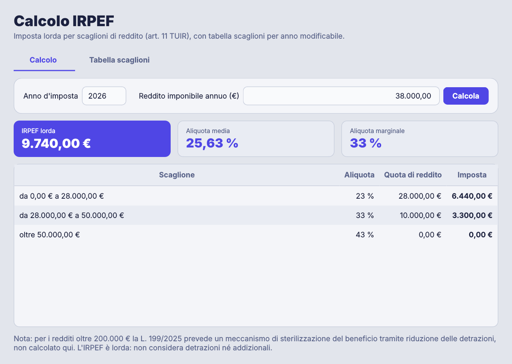

- Tabella degli scaglioni **per anno**: sono già presenti **2024, 2025 e 2026** (nel 2026 il secondo scaglione passa al 33 %).
- La tabella è **modificabile** e si può creare un nuovo anno copiando l'ultimo: quando cambia la legge di bilancio non serve aspettare un aggiornamento del programma.
- Esempio: imponibile 38.000 € nel 2026 → IRPEF lorda **9.740,00 €**.

Vedi la tabella degli scaglioni

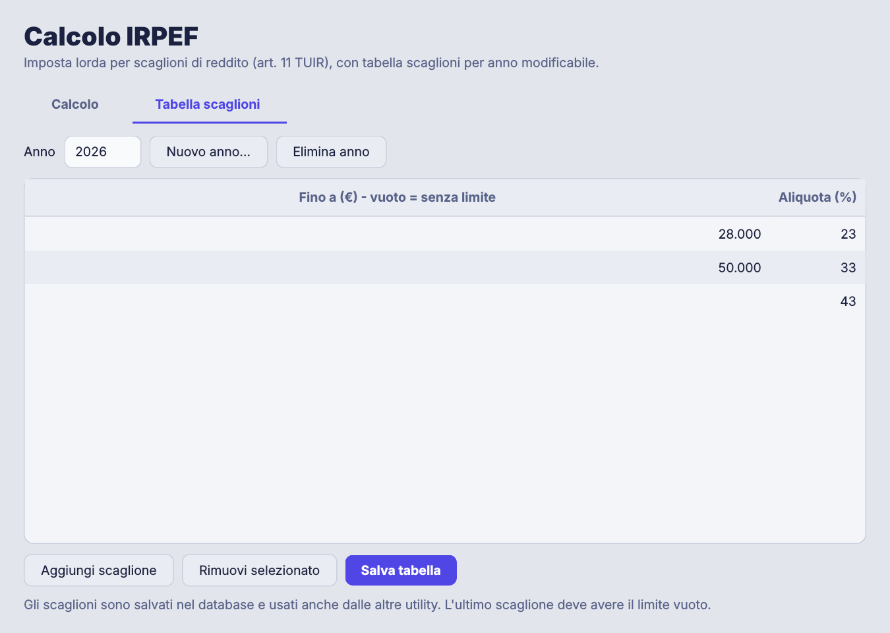

### 2. Detrazioni lavoro dipendente

Determina in un colpo solo **tutto ciò che spetta al dipendente** nell'anno: detrazione per lavoro dipendente, ulteriore detrazione, **somma (indennità aggiuntiva)**, trattamento integrativo e **totale spettante**, con l'IRPEF netta risultante.

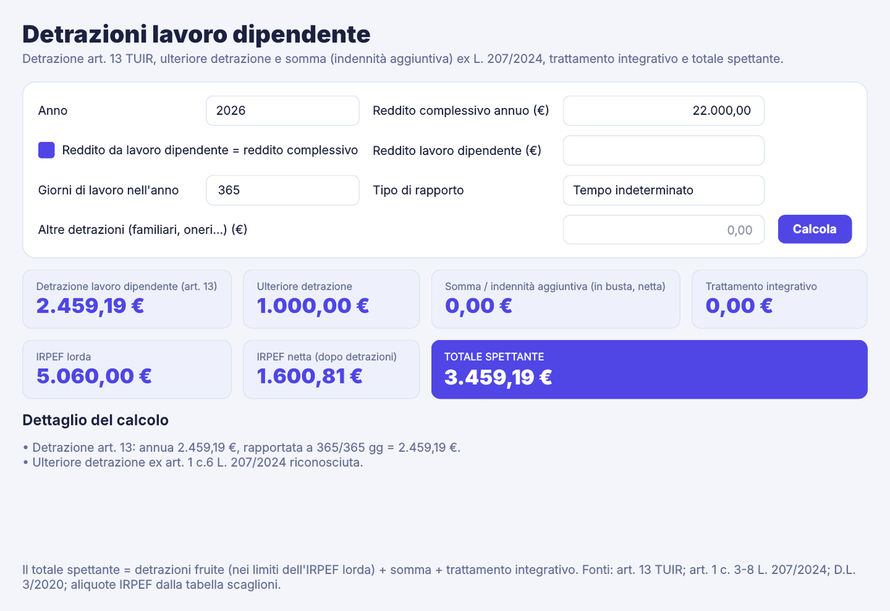

- Calcolo **rapportato ai giorni di lavoro**, con distinzione tempo indeterminato / determinato.
- Campo per le **altre detrazioni** (familiari a carico, oneri) che entrano nell'imposta netta e nel test di capienza.
- Sotto il risultato compare il **dettaglio delle regole applicate**: si vede perché spetta o non spetta ogni componente.
- Esempio: reddito 22.000 € nel 2026 → detrazione 2.459,19 € + ulteriore detrazione 1.000,00 €.

### 3. Split file CSV

Prende un file CSV e lo **divide in più file** in base alla colonna scelta: prima ordina i valori, poi crea **un file per ogni valore diverso** (per filiale, per centro di costo, per società…).

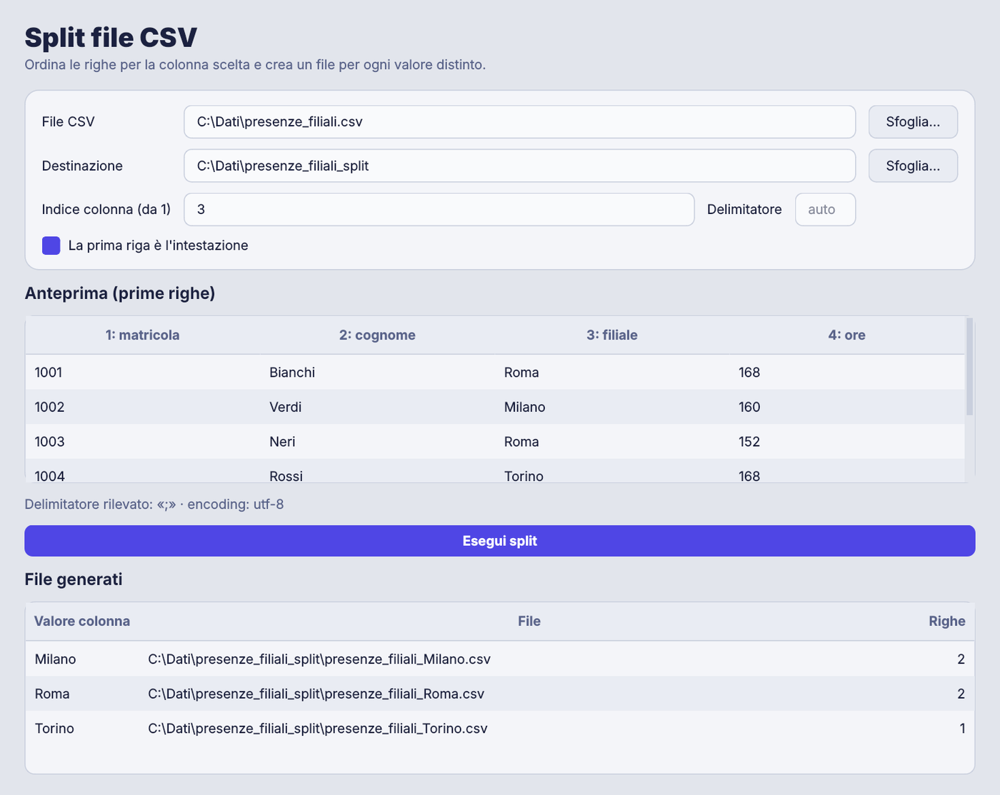

- Anteprima delle prime righe, riconoscimento automatico del separatore e della codifica del file.
- Intestazione ripetuta in ogni file; nomi dei file sempre validi per Windows, anche con valori vuoti o caratteri speciali.
- Gestisce i campi con testo su più righe e mantiene separatore e codifica del file originale.

### 4. Costo del lavoro

Calcola il **costo annuo di un dipendente** per l'azienda a partire dagli elementi di paga che inserisci, con il dettaglio di ogni elemento di costo e **report finale in PDF o Word**.

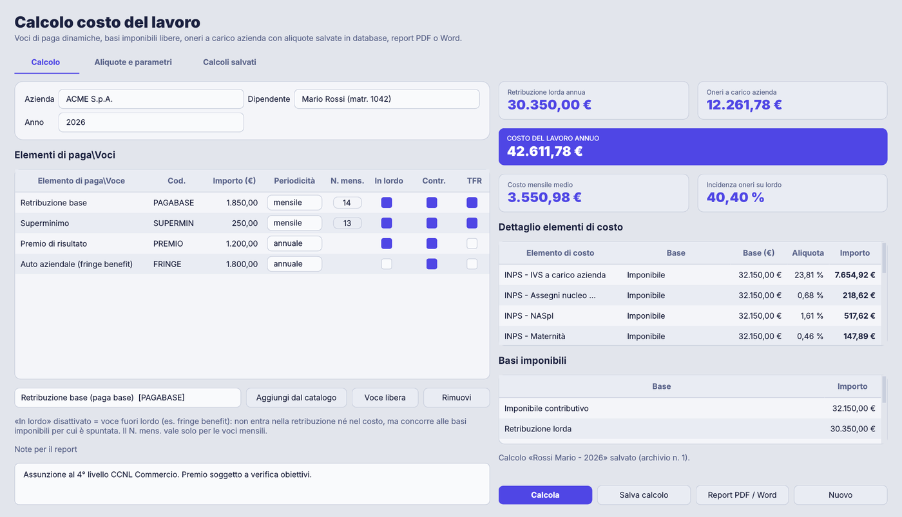

- **Elementi di paga\Voci dinamici**: aggiungi le voci che ti servono (da catalogo o libere), mensili o annuali. Per le voci mensili indichi **il numero di mensilità** (proposto 12; 13, 14… voce per voce): l'importo viene moltiplicato per le mensilità della riga.
- **Voci fuori lordo**, come i *fringe benefit*: non entrano nel lordo né nel costo, ma **aumentano gli imponibili** che indichi (contributivo, TFR, basi tue).
- **Aliquote per ogni elemento di costo**, salvate e modificabili, in **% o in ‰** (il tasso INAIL è per mille): aggiungi quante aliquote vuoi (contributi, TFR, INAIL, fondi, enti bilaterali, importi fissi…).
- **Basi imponibili tue**: oltre a imponibile, lordo e base TFR puoi creare una base come **somma algebrica di alcune voci** (per esempio «lordo − premio + fringe benefit») e applicarvi un'aliquota.
- **Report in PDF o Word**, a tua scelta, con dettaglio, basi, riepilogo e **le tue note**.
- **Calcoli salvati**: li richiami quando vuoi, anche dopo mesi, ritrovando dati e aliquote dell'epoca.

<table>
<tr>
<td width="50%">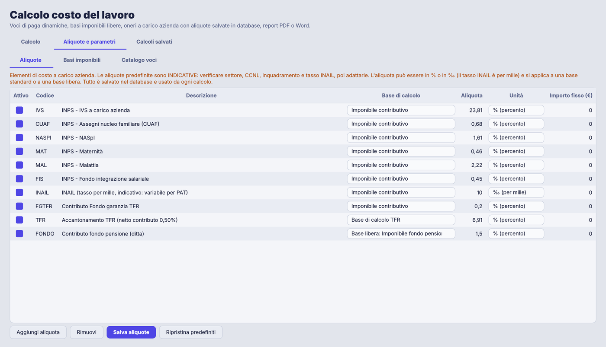 Aliquote: base di calcolo e unità (% o ‰)</td>
<td width="50%">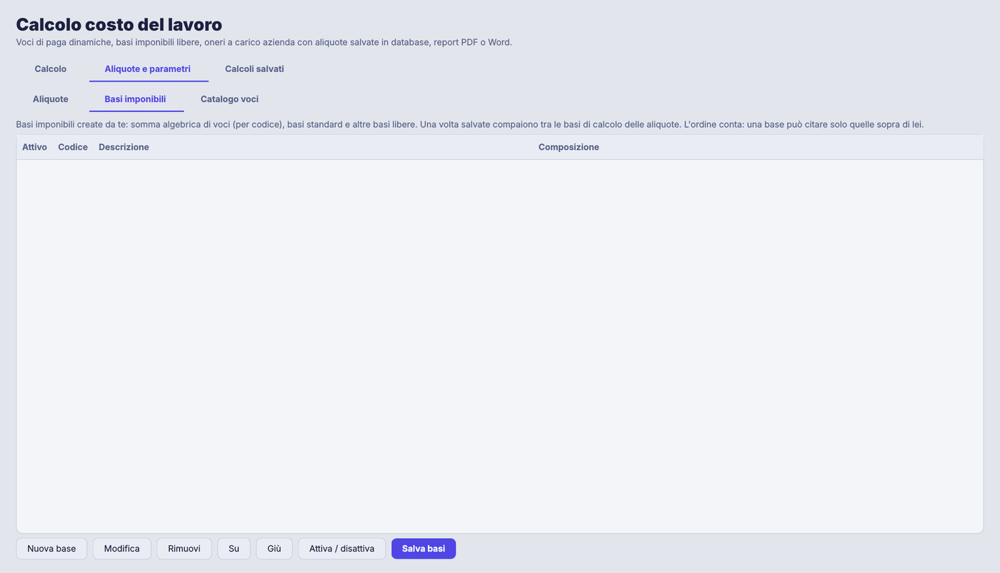 Basi imponibili create da te</td>
</tr>
<tr>
<td width="50%">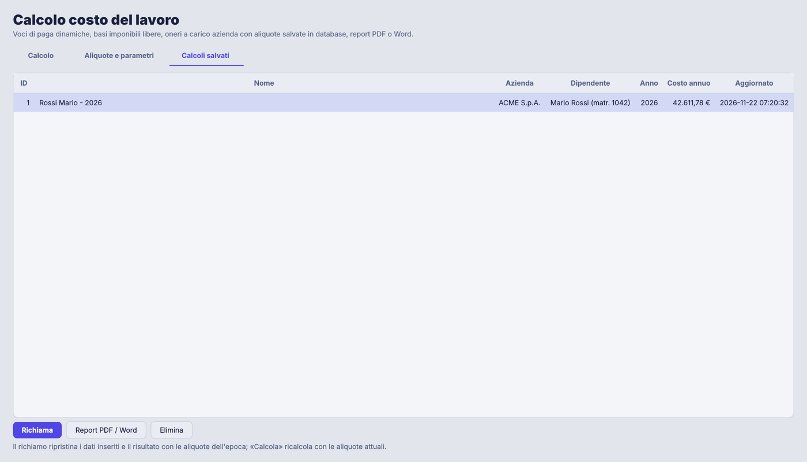 Calcoli salvati</td>
<td width="50%">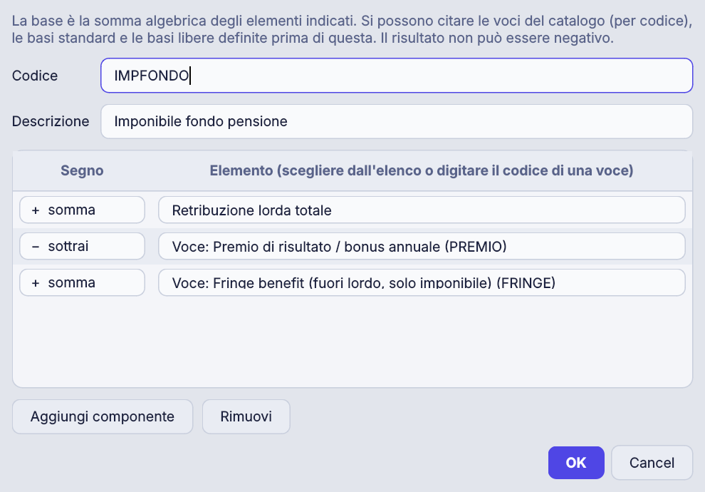 Come si definisce una base</td>
</tr>
</table>

<table>
<tr>
<td width="50%" align="center">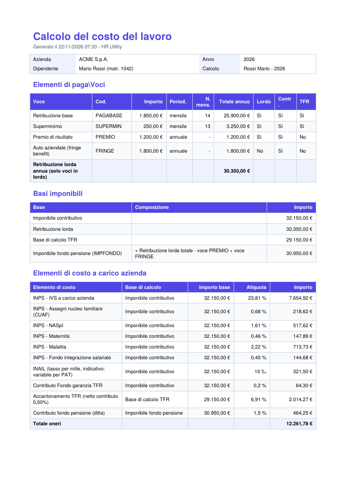 Report PDF (dati di esempio)</td>
<td width="50%" align="center">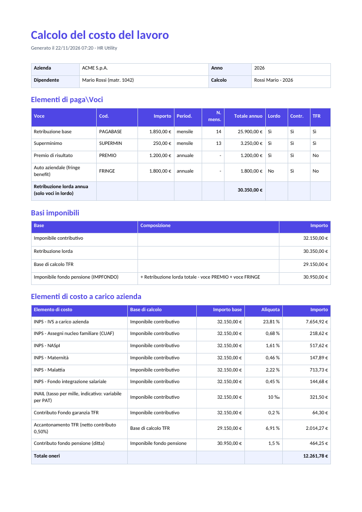 Lo stesso report in Word</td>
</tr>
</table>

> ⚠️ Le aliquote contributive predefinite sono **indicative**: vanno verificate e adattate al proprio caso prima dell'uso professionale.

---

## Come si presenta

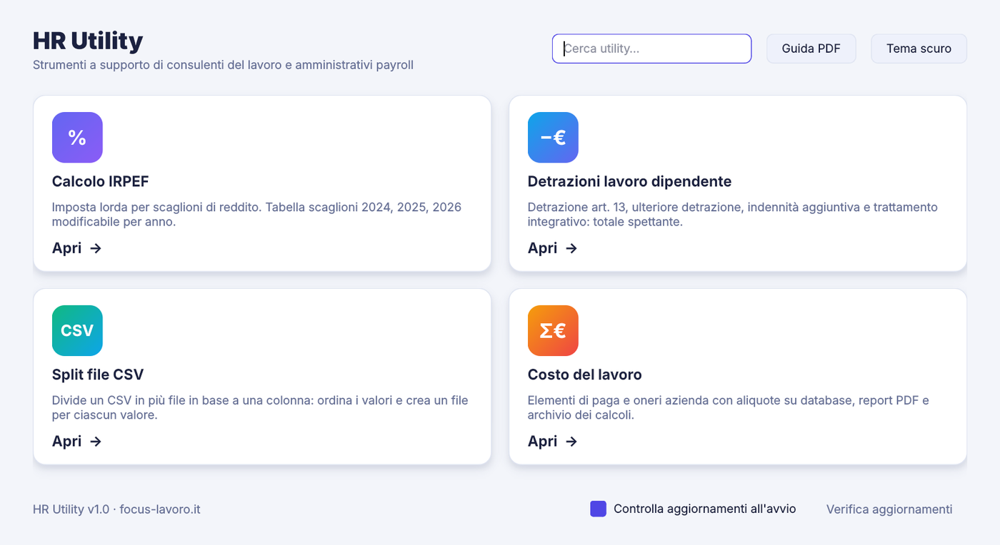

- **Portale a icone**: una card per ogni utility, con ricerca rapida.
- **Tema chiaro e moderno**, in un grigio riposante per l'uso prolungato (con tema scuro opzionale).
- **Codice a 3 lettere** su ogni card (IRP, DET, CSV, CDL): identifica il modulo nella licenza.
- **Guida integrata** apribile con un clic.
- Ogni utility si apre in una **finestra propria**: puoi tenerne aperte più di una.

## Scarica e installa

1. Apri la pagina **[Releases](https://github.com/GITHUB_UTENTE/HRUtilityApp/releases/latest)**.
2. Scarica **`HRUtility_Setup_<versione>.exe`** (installer) oppure lo **zip portatile**.
3. Avvia l'installer: non servono diritti di amministratore. Troverai HR Utility nel menu Start.

**Requisiti:** Windows 10 o 11 a 64 bit.

> 🛡️ Se Windows mostra *«Windows ha protetto il PC»*: clic su **Ulteriori informazioni → Esegui comunque**. Succede con le applicazioni non ancora riconosciute da Microsoft. Scarica il programma solo da questa pagina.

## Licenza

L'uso di HR Utility è regolato da una **licenza con scadenza e per moduli**: ogni utility ha un codice di 3 caratteri e la licenza abilita i moduli scelti fino alla data di scadenza.

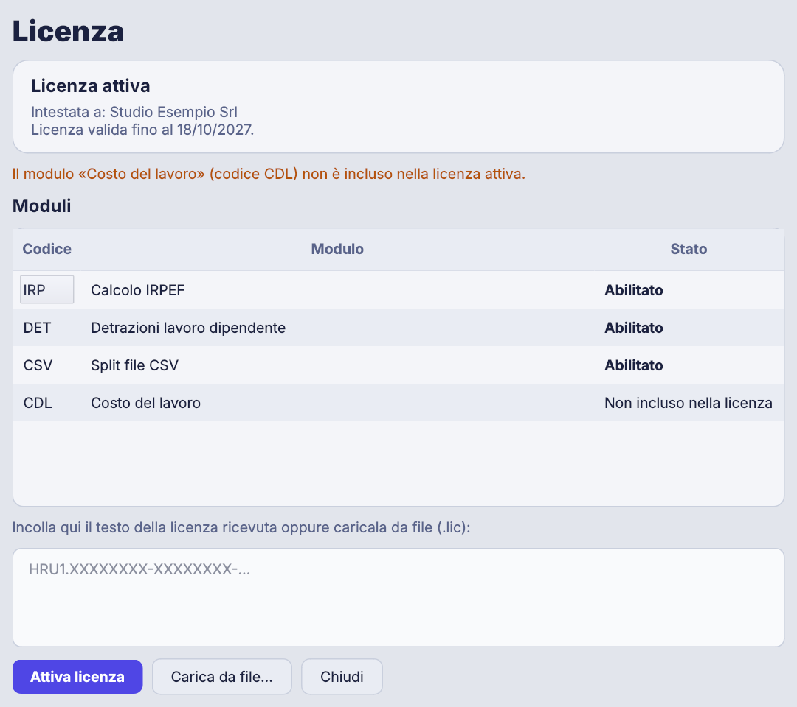

- **Attivazione semplice**: pulsante *Licenza…* in basso nel portale, incolla il testo ricevuto (o carica il file `.lic`) e premi *Attiva licenza*. Funziona **senza Internet**.
- **Moduli**: quelli non inclusi sono segnalati sulla card come *«Non incluso nella licenza»*; ampliare la licenza è sufficiente per abilitarli.
- **Scadenza**: nei 30 giorni precedenti il portale mostra i giorni residui. A licenza scaduta i moduli si bloccano ma **i tuoi dati restano intatti** e tornano disponibili con il rinnovo.
- Per ottenere, ampliare o rinnovare una licenza scrivi tramite [focus-lavoro.it](https://focus-lavoro.it).

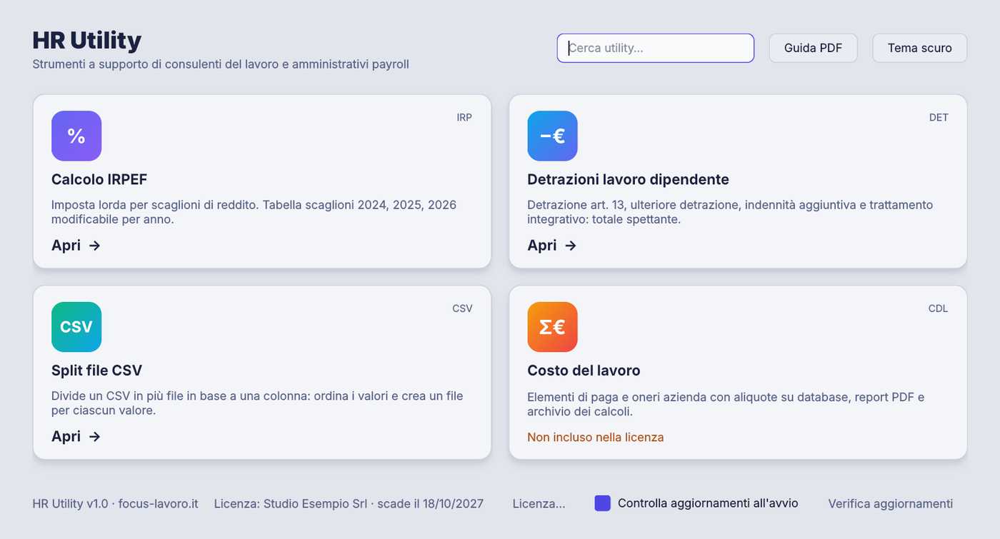

## Aggiornamenti

HR Utility può **avvisarti quando esce una nuova versione**: all'avvio, o quando premi *Verifica aggiornamenti* in basso nel portale.

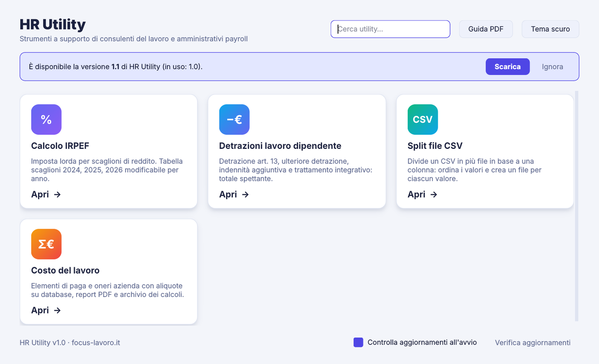

- Compare un avviso con il pulsante **Scarica**, che apre questa pagina: l'aggiornamento non è automatico.
- **Ignora** nasconde l'avviso fino alla versione successiva.
- Il controllo all'avvio si disattiva con la casella *Controlla aggiornamenti all'avvio*.
- **Non viene inviato nessun dato personale, nessun dato dei calcoli, nessun file.** Come per qualsiasi sito web, GitHub vede l'indirizzo IP di chi si collega.
- Senza connessione il programma funziona normalmente.

Dati e impostazioni si conservano quando si installa una nuova versione.

## I tuoi dati restano tuoi

Tutto funziona **sul tuo computer**: i calcoli, i file e i report non vengono inviati da nessuna parte. Scaglioni modificati, aliquote, basi imponibili, calcoli salvati, licenza e impostazioni sono nella cartella `%APPDATA%\HRUtility` del tuo profilo Windows (incollala in Esplora risorse).

- **Backup:** copia quella cartella con il programma chiuso.
- **Ripristino / altro PC:** rimettila allo stesso posto.
- Eliminandola si torna ai valori predefiniti. Aggiornamenti e disinstallazione non la toccano.

## Riferimenti normativi

Le regole di calcolo seguono le fonti qui sotto; i dettagli sono nella [guida PDF](docs/HR_Utility_Guida_1.0.pdf).

| Argomento | Fonte |
|---|---|
| Aliquote e scaglioni IRPEF | Art. 11 TUIR (DPR 917/1986); D.Lgs. 216/2023; L. 207/2024; L. 199/2025, art. 1 c. 3 (aliquota 33 % dal 2026) |
| Detrazione lavoro dipendente | Art. 13 c. 1 TUIR, come modificato dal D.Lgs. 216/2023 |
| Somma (indennità aggiuntiva) e ulteriore detrazione | L. 207/2024, art. 1 c. 4-8 |
| Trattamento integrativo | D.L. 3/2020 e successive modificazioni |

Dal 1° gennaio 2027 entra in vigore il nuovo testo unico delle imposte sui redditi (D.Lgs. 19 giugno 2026, n. 117): i riferimenti sopra riguardano il TUIR applicabile ai periodi 2024-2026.

## Limiti e avvertenze

- Sono **strumenti di supporto**: non sostituiscono l'elaborazione paghe, il conguaglio fiscale né la valutazione del professionista, che resta responsabile dei risultati.
- **Non sono gestiti:** addizionali regionali e comunali, riduzioni e agevolazioni specifiche, contribuzione del lavoratore e netto in busta, calcoli su più rapporti di lavoro, sterilizzazione 2026 oltre 200.000 €.
- Il calcolo delle detrazioni assume che il reddito complessivo coincida con l'imponibile e con il reddito di lavoro dipendente (si può indicare un reddito di lavoro dipendente diverso).
- Normativa e aliquote cambiano: verifica sempre i valori alla luce di leggi, circolari e CCNL.
- Il programma è fornito *«così com'è»*, senza garanzie di alcun tipo.

---

## 🤝 Contribuisci: fai crescere HR Utility App

HR Utility App ha **quattro utility oggi, ma l'obiettivo è averne molte di più**, scelte da chi lavora ogni giorno con paghe, cedolini e adempimenti. Il tuo punto di vista conta più di qualsiasi progetto a tavolino.

**Il codice del programma non è pubblico**, quindi non serve saper programmare: si contribuisce con **idee, esperienza e prove sul campo**.

### Come puoi aiutare

| Cosa | Come |
|---|---|
| 💡 **Proporre una nuova utility** | [Apri una proposta](https://github.com/GITHUB_UTENTE/HRUtilityApp/issues/new?template=proposta-utility.yml): descrivi il problema, i dati che hai in mano e il risultato che vorresti |
| 🛠️ **Migliorare una utility esistente** | [Suggerisci un miglioramento](https://github.com/GITHUB_UTENTE/HRUtilityApp/issues/new?template=miglioramento.yml) |
| 🐞 **Segnalare un errore o un risultato diverso dal tuo software paghe** | [Segnala un errore](https://github.com/GITHUB_UTENTE/HRUtilityApp/issues/new?template=segnalazione-errore.yml), con fonte normativa se possibile |
| 💬 **Discutere, votare le idee, condividere un caso d'uso** | [Discussioni](https://github.com/GITHUB_UTENTE/HRUtilityApp/discussions) |
| ⭐ **Far conoscere il progetto** | Lascia una stella al repository e passalo a colleghi e studi |

### Una buona proposta contiene

1. **Il problema concreto**: cosa fai oggi a mano o con fogli Excel, e quanto tempo ti porta via.
2. **I dati in ingresso** (che formato hanno) e **il risultato atteso**.
3. **Un esempio con numeri di fantasia** e, se esiste, il **riferimento normativo** (legge, circolare INPS/AdE, articolo di CCNL).

> 🔒 **Non pubblicare mai dati reali** di dipendenti, aziende o clienti (nomi, codici fiscali, importi riferibili a persone): usa sempre valori di fantasia.

### Idee su cui mi piacerebbe un tuo parere

Sono **spunti, non impegni**: dimmi quali ti servirebbero davvero e in che forma.

- Calcolo del **TFR** (accantonamento, rivalutazione, anticipazioni)
- **Ratei** di ferie, permessi, 13ª e 14ª
- **Addizionali** regionali e comunali
- **Simulatore di conguaglio** fiscale
- **Lordo ↔ netto** (stima)
- **Validatori**: codice fiscale, IBAN, partita IVA
- Strumenti per i **file**: unire e confrontare CSV, controllo di coerenza
- **Scadenzario** degli adempimenti paghe

Le proposte più richieste e meglio descritte passano in testa alla lista. Maggiori dettagli in [CONTRIBUTING.md](CONTRIBUTING.md).

---

## Domande frequenti

**Funziona senza Internet?** Sì, anche l'attivazione della licenza. Internet serve solo per il controllo facoltativo delle nuove versioni.

**Cosa succede quando la licenza scade?** I moduli si bloccano, i dati restano sul tuo computer e tornano utilizzabili appena attivi una licenza rinnovata.

**Come si indicano 13ª e 14ª nel costo del lavoro?** Nella riga di ogni voce mensile imposti il numero di mensilità (12, 13, 14…): l'importo viene moltiplicato per quel numero.

**I miei dati vengono inviati da qualche parte?** No. Tutto resta sul tuo computer (vedi [I tuoi dati restano tuoi](#i-tuoi-dati-restano-tuoi)).

**Il risultato differisce di pochi centesimi dal mio software paghe. Perché?** Spesso dipende dal modo di arrotondare i rapporti nelle formule di detrazione. La guida spiega i passaggi, così puoi confrontarli. Se pensi sia un errore, [segnalalo](https://github.com/GITHUB_UTENTE/HRUtilityApp/issues/new?template=segnalazione-errore.yml).

**Posso usarlo su più PC dello studio?** Sì: ogni PC ha i propri dati. Per portare scaglioni, aliquote e calcoli salvati su un altro PC copia la cartella descritta sopra.

**Esiste per Mac o Linux?** Al momento solo Windows 10/11.

**Quando esce l'aggiornamento con le nuove regole fiscali?** Gli scaglioni IRPEF e le aliquote del costo del lavoro li aggiorni da solo nel programma; le regole delle detrazioni arrivano con le nuove versioni, annunciate in [Releases](https://github.com/GITHUB_UTENTE/HRUtilityApp/releases).

---

## Cronologia versioni

| Versione | Contenuto |
|---|---|
| **1.0** | Prima versione: portale con tema chiaro e controllo della versione; licenza a moduli con scadenza; Calcolo IRPEF 2024-2026; Detrazioni lavoro dipendente; Split file CSV; Costo del lavoro (mensilità per voce, voci fuori lordo, basi imponibili libere, aliquote in % e ‰, report PDF o Word, archivio calcoli); guida PDF. |

---

## Autore e contatti

Un progetto di **[focus-lavoro.it](https://focus-lavoro.it)**, piattaforma per HR manager e consulenti del lavoro.
Per idee, segnalazioni e domande usa le [Issues](https://github.com/GITHUB_UTENTE/HRUtilityApp/issues) e le [Discussioni](https://github.com/GITHUB_UTENTE/HRUtilityApp/discussions) di questo repository.

HR Utility App è uno strumento indipendente e non è affiliato ad alcun produttore di software paghe. Tutti i marchi citati appartengono ai rispettivi proprietari.
